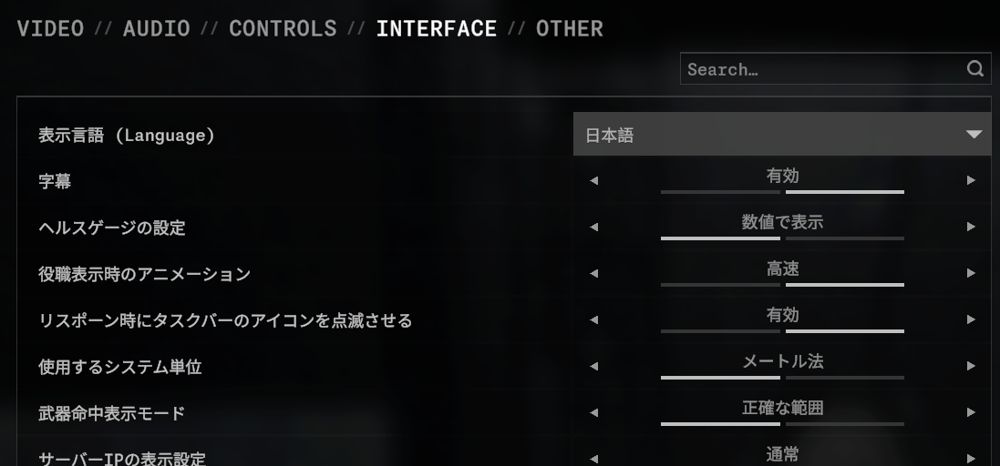

# SCP: Secret Laboratory 日本語翻訳プロジェクト

[日本語](README.md) | [English](README.en.md)

  

## Discordサーバー

ディスコードサーバーではサポートが受けられたり、更新時にお知らせしてくれたり、翻訳コーディネーターを募集しています。興味ある方は是非！

## 概要
SCP: Secret Laboratory (SCPSL) の日本語翻訳プロジェクトへようこそ！このプロジェクトは、ゲーム内のすべてのテキストを日本語に翻訳し、日本のプレイヤーがより快適にゲームを楽しめるようにすることを目的としています。

## プロジェクト目標
- ゲーム内のすべてのテキストを日本語に翻訳
- 定期的なアップデートと改善

## インストール方法
1. **リリースされたバージョンのバージョンタグ.zipをダウンロード**：
      
2. **ディレクトリにフォルダごと入れる**：
    `\SteamLibrary\steamapps\common\SCP Secret Laboratory\Translations` にフォルダごと入れてください。ディレクトリの開き方はSteamを開いて以下の画像のようにして開きます。
    

3. **ゲーム内設定から言語を変更する**：
    
    
    翻訳ファイルを完全に適用するためにゲームを再起動することを推奨します。
## インストーラーを使用するインストール方法

### Windows 11 / Windows x64
リリースページの **`SCPSL.exe`** をダウンロードして起動してください。

現在のインストーラーは **C++/WinRT（WinUI 3）＋Rust** で作られたネイティブ版です。以前の.NET版と異なり、Windows App Runtime、.NET、WebView2の追加インストールは不要です。単一EXE（約26MB）の中に必要なランタイムが含まれ、初回起動時にアプリ専用フォルダーに展開されます。

1. [Releases](https://github.com/hayabusa255/SCPSLTranslationJP/releases)から `SCPSL.exe` をダウンロードします。
2. ゲームを終了してから起動します。SteamのSCP: Secret Laboratory保存先が自動検出されない場合は、手動でゲームフォルダーを選択します。
3. 「更新履歴とバージョン切り替え」から、**安定版・Beta版**の日本語訳を選択して導入できます。既存版から切り替えるときは確認ダイアログが表示されます。
4. ゲーム内の言語設定を日本語に変更してください。適用後はゲームの再起動を推奨します。

> v15.0 Private Beta向けの翻訳はベータ版のため、対応ゲームバージョンをご確認ください。実ゲームへの導入テストは今後も継続します。

### Linux / Steam Deck
現在の新しいWinUIネイティブインストーラーはWindows専用です。Linux / Steam Deckではリリースの `JP-Ver*.zip` をダウンロードし、解凍したフォルダーをゲームの `Translations` 配下に配置してください。

旧 `SCPSL-linux-x64` の新規配布は終了しています。

### プロジェクト貢献者一覧

<table>
  <tr>
    <td align="center">
      <a href="https://github.com/hayabusa255">
        
         
        <b>hayabusa255</b>
      </a>
       
      役割: 総合管理者
       
      貢献内容: 日本語化インストーラーの開発、主要翻訳の実施、翻訳の品質管理
    </td>
    <td align="center">
      <a href="https://github.com/PikutoSun2">
        
         
        <b>ピクトさん</b>
      </a>
       
      役割: 翻訳コーディネーター
       
      貢献内容: 主要翻訳の実施、翻訳の品質管理
    </td>
    <td align="center">
      <a href="https://github.com/2UCL">
        
         
        <b>2UCL</b>
      </a>
       
      役割: 翻訳コーディネーター
       
      貢献内容: 主要翻訳の実施、翻訳の品質管理
    </td>
  </tr>
</table>

## ライセンス
`JP/` ディレクトリ内の日本語翻訳ファイルは、Creative Commons Attribution 4.0 International License (CC BY 4.0) の下で提供されます。再配布・改変・利用時は `SCPSLTranslationJP contributors` とリポジトリ URL を表示してください。詳細は `JP/LICENSE.md` を参照してください。

インストーラーなどのソースコードは MIT ライセンスの下で提供されます。詳細は `LICENSE` ファイルを参照してください。

SCP: Secret Laboratory、原文、名称、関連アセットの権利は各権利者に帰属します。
